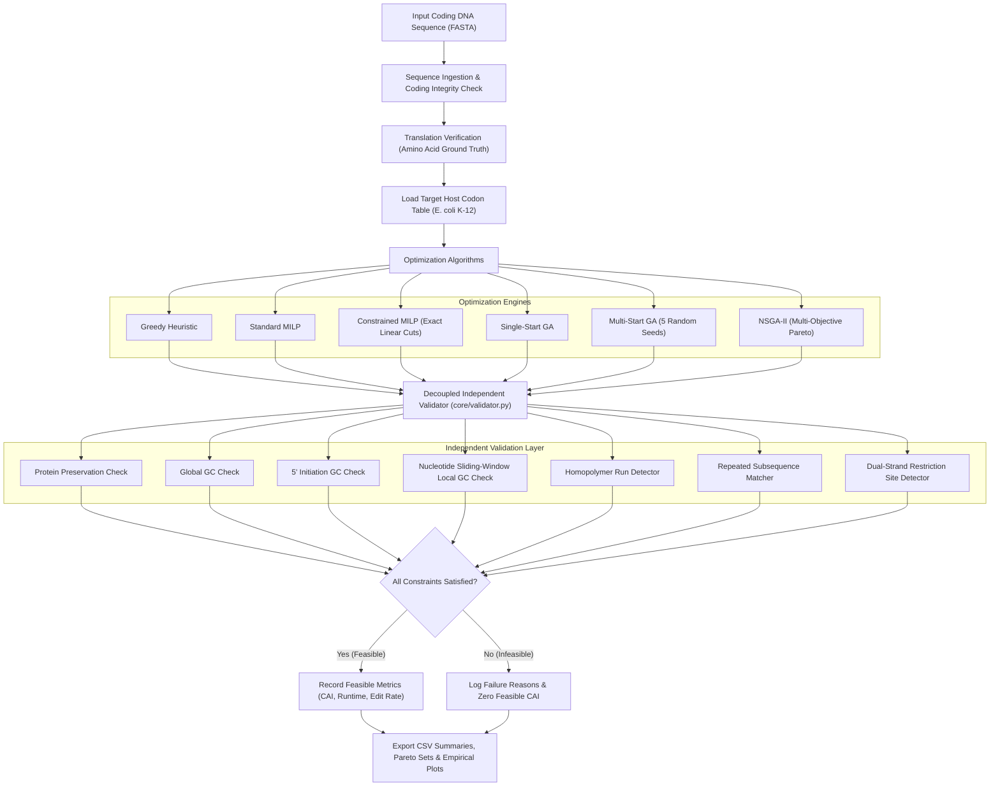
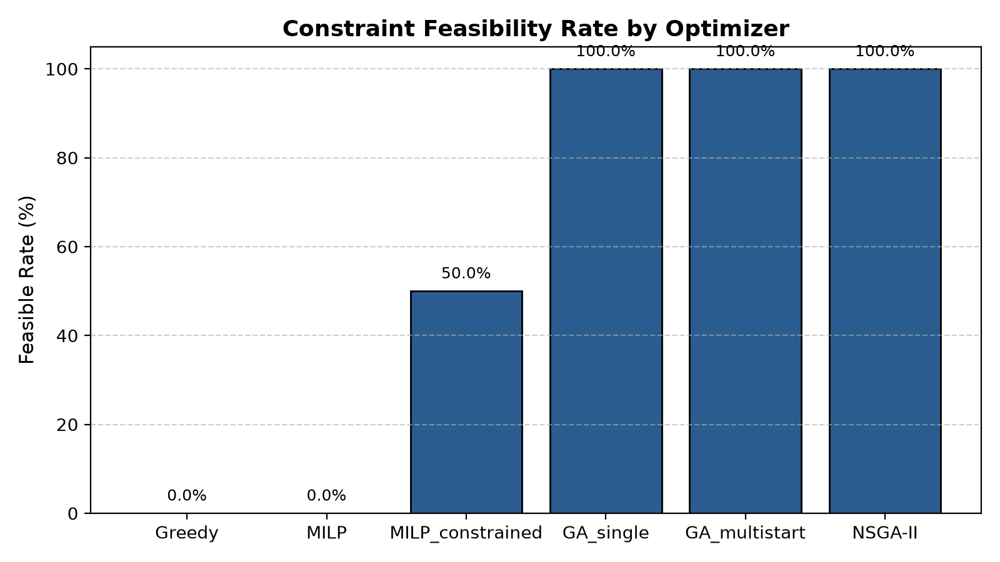
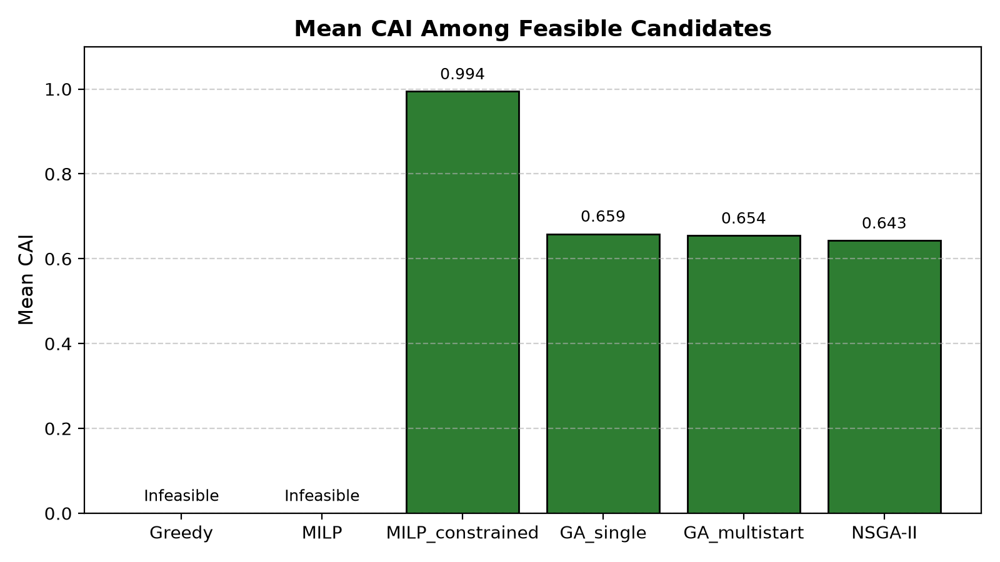
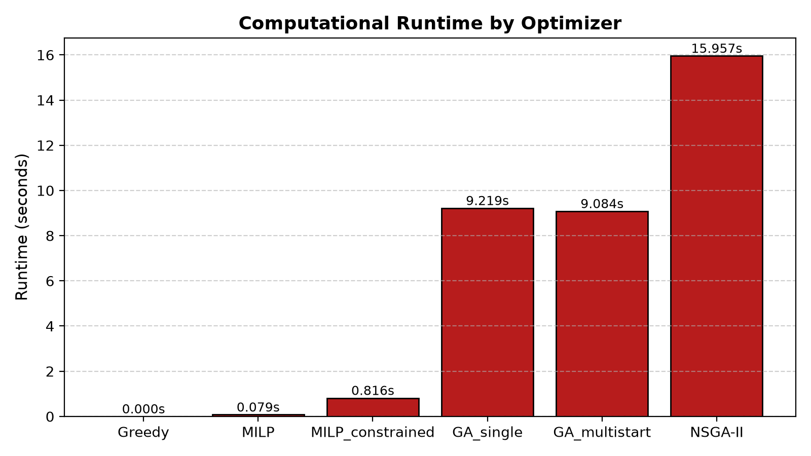
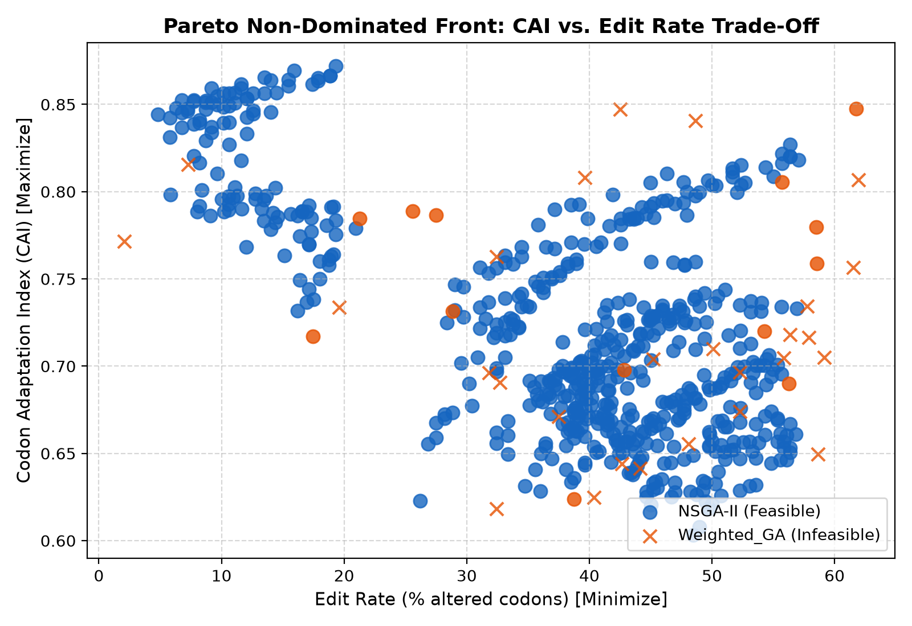
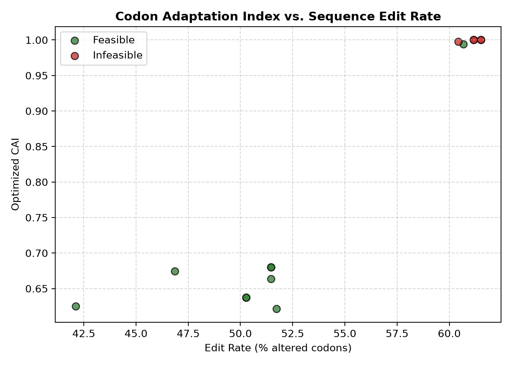
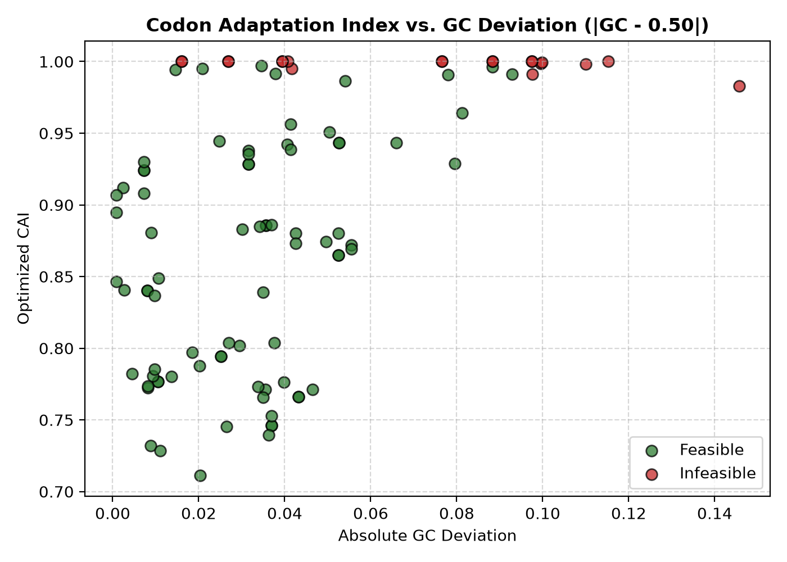
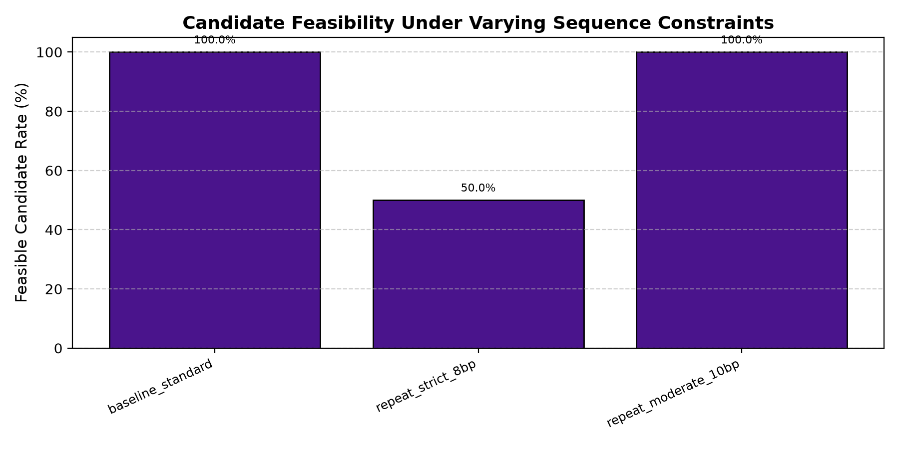
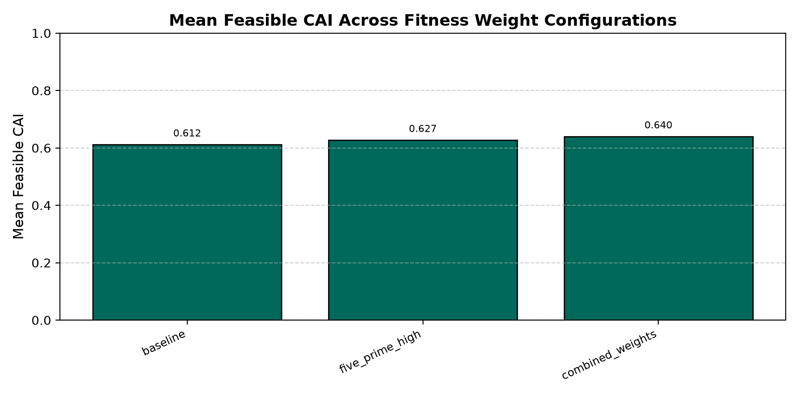

# Codon Optimization Using Constraint-Aware Algorithms

A bioinformatics framework for synonymous DNA sequence optimization using Greedy Search, Mixed-Integer Linear Programming (MILP), Genetic Algorithms (GA), Multi-Start GA, and NSGA-II.

[](https://www.python.org/)
[](https://en.wikipedia.org/wiki/Bioinformatics)
[](https://en.wikipedia.org/wiki/Codon_usage_bias)
[](https://docs.pytest.org/)

---

## Table of Contents

1. [Overview and Biological Background](#overview-and-biological-background)
2. [Objectives](#objectives)
3. [Constraint Framework and Biological Rationale](#constraint-framework-and-biological-rationale)
4. [System Architecture and Independent Validation](#system-architecture-and-independent-validation)
5. [Optimization Algorithms](#optimization-algorithms)
6. [Benchmark Results and Comparative Analysis](#benchmark-results-and-comparative-analysis)
7. [Visualizations and Empirical Plots](#visualizations-and-empirical-plots)
8. [Benchmark Dataset Manifest](#benchmark-dataset-manifest)
9. [Project Layout](#project-layout)
10. [Installation and Environment Setup](#installation-and-environment-setup)
11. [Running Tests and Verification](#running-tests-and-verification)
12. [Running Experiments](#running-experiments)
13. [Limitations and Scientific Scope](#limitations-and-scientific-scope)
14. [Future Work](#future-work)
15. [Reproducibility and Metadata](#reproducibility-and-metadata)
16. [Author and Citation](#author-and-citation)

---

## Overview and Biological Background

Codon optimization is the computational redesign of a coding DNA sequence (CDS) to improve expression in a heterologous target host while strictly preserving the translated amino acid sequence. Due to the degeneracy of the universal genetic code, 18 of the 20 standard amino acids are encoded by multiple synonymous codons (ranging from two codons for amino acids such as Glutamic Acid to six codons for Arginine, Leucine, and Serine).

In natural organisms, synonymous codons are not utilized with equal frequency. Each host organism exhibits characteristic codon usage bias driven by evolutionary selection for translational efficiency, translation fidelity, and genomic GC balance. Highly expressed genes typically feature codons corresponding to the most abundant cognate transfer RNA (tRNA) pools. When a wild-type gene from an organism such as *Homo sapiens* or *Photinus pyralis* is expressed in a bacterial host such as *Escherichia coli*, rare codons can cause ribosome stalling, premature translational termination, mRNA instability, and reduced yield.

### The Codon Adaptation Index (CAI)

The standard quantitative metric for codon usage compatibility is the Codon Adaptation Index (Sharp and Li, 1987). For each codon $j$ encoding amino acid $i$, the relative adaptiveness $w_{ij}$ is defined as:

$$w_{ij} = \frac{f_{ij}}{\max_k (f_{ik})}$$

where $f_{ij}$ is the frequency of codon $j$ for amino acid $i$ in a reference set of highly expressed host genes. For a coding sequence of length $L$ codons, the sequence CAI is computed as the geometric mean of relative adaptiveness values:

$$\text{CAI} = \exp \left( \frac{1}{L} \sum_{m=1}^{L} \ln(w_m) \right) = \left( \prod_{m=1}^{L} w_m \right)^{1/L}$$

A CAI of 1.0 represents a sequence composed exclusively of the host's most preferred synonymous codons.

### Critical Distinction: CAI vs. Protein Expression

A high CAI is a mathematical optimization objective and does not automatically guarantee increased recombinant protein yield *in vivo*. High-level expression depends on multiple physical and biological phenomena beyond codon frequency:
- **5' mRNA Secondary Structure**: Stable RNA stem-loops near the translation initiation region (the first ~60 nt) inhibit ribosome binding site (RBS) accessibility and dramatically reduce translation initiation rates.
- **Local Ribosome Elongation Dynamics**: Extreme codon usage uniformity can deplete specific aminoacyl-tRNA pools, causing translational pauses or protein misfolding.
- **Repeats and Homopolymers**: Repeated nucleotide motifs promote intra-molecular recombination, while homopolymers cause RNA polymerase slippage and transcriptional frameshifts.
- **Cloning Compatibility**: Unwanted restriction enzyme recognition sites interfere with recombinant vector assembly (e.g., standard Golden Gate or BioBrick restriction digestions).

Consequently, robust codon optimization requires **constraint-aware multi-objective optimization** coupled with an **independent validation layer**.

---

## Objectives

1. **Preserve Protein Primary Structure**: Guarantee 100% translation identity between original and optimized sequences across all synonymous substitutions.
2. **Maximize Host Codon Adaptation**: Improve CAI relative to the *Escherichia coli* K-12 codon usage distribution.
3. **Enforce Sequence Constraints**: Satisfy multi-scale biophysical constraints including global GC bounds, 5' initiation GC bounds, sliding-window local GC content, homopolymer limits, repeated subsequence thresholds, and cloning restriction enzyme exclusion.
4. **Compare Diverse Algorithmic Paradigms**: Systematically benchmark Greedy heuristic selection, standard Mixed-Integer Linear Programming (MILP), fully constrained MILP, single-start Genetic Algorithms (GA), multi-start GA, and Non-dominated Sorting Genetic Algorithm II (NSGA-II).
5. **Decouple Optimization from Validation**: Route all candidate sequences through an independent, decoupled sequence validator to prevent optimizers from self-reporting artificial feasibility.
6. **Provide Reproducible Research Pipelines**: Maintain deterministic random seeds, dataset manifests, machine-readable CSV outputs, and publication-ready visualizations.

---

## Constraint Framework and Biological Rationale

The benchmark configuration employs seven computational sequence design rules:

| Constraint | Benchmark Threshold | Biological and Experimental Rationale |
|---|---|---|
| **Global GC Content** | 40.0% – 60.0% | Maintains genomic compatibility with the *E. coli* chromosome (~50.8% GC) and prevents extreme base composition biases that impair DNA stability. |
| **5' Region GC Content** | 40.0% – 50.0% (first 60 bp) | Lower GC content in the initiation region reduces the thermodynamic stability of secondary RNA structures ($\Delta G$), ensuring ribosome accessibility to the Shine-Dalgarno sequence. |
| **Local Sliding-Window GC** | 30.0% – 70.0% (60 bp window, step 1 nt) | Prevents local GC spikes that form high-melting-temperature secondary structures or AT-rich pause sites that destabilize mRNA. |
| **Maximum Homopolymer Run** | Maximum 6 consecutive identical bases | Homopolymer runs ($A_n, C_n, G_n, T_n \ge 7$) induce DNA polymerase slippage during PCR amplification and RNA polymerase slippage during transcription. |
| **Repeated Subsequence Limit** | Prohibit identical repeats $\ge 12$ bp | Repeated motifs promote homologous recombination, sequence instability, and synthesis failures during gene synthesis. |
| **Forbidden Restriction Sites** | Zero occurrences of EcoRI (`GAATTC`), BamHI (`GGATCC`), HindIII (`AAGCTT`), NdeI (`CATATG`), XhoI (`CTCGAG`) | Prevents internal cleavage during downstream molecular cloning and vector assembly; evaluated on both forward and reverse-complement strands. |
| **Protein Preservation** | Invariant (100% amino acid identity) | Strict preservation of functional primary structure; premature stops and frame alterations are disallowed. |

---

## System Architecture and Independent Validation

A fundamental design principle of this framework is the strict decoupling between optimization heuristics and candidate validation:



An optimizer cannot mark a candidate as feasible merely because its internal penalty function reached a local optimum. All candidates pass into `core/validator.py`, which evaluates each rule independently and returns boolean flags, quantitative measurements, and specific failure strings.

---

## Optimization Algorithms

### 1. Greedy Search (`optimizers/greedy.py`)
- Selects the single synonymous codon with the highest host frequency for every amino acid position:
  $$c_p^* = \arg\max_{c \in \text{Syn}(a_p)} f(c)$$
- Computational complexity: $O(N)$ where $N$ is sequence length.
- Serves as the unconstrained upper-bound baseline for CAI.

### 2. Standard Mixed-Integer Linear Programming (`optimizers/milp.py`)
- Formulates codon selection as an integer linear program solved via CBC:
  $$\max \sum_{p=1}^{N} \sum_{c \in \text{Syn}(a_p)} f(c) \cdot x_{p,c}$$
  subject to:
  $$\sum_{c \in \text{Syn}(a_p)} x_{p,c} = 1 \quad \forall p \in \{1, \dots, N\}$$
  $$\text{GC}_{\min} \cdot 3N \le \sum_{p=1}^{N} \sum_{c} \text{GC}(c) \cdot x_{p,c} \le \text{GC}_{\max} \cdot 3N$$
- Decision variables: $x_{p,c} \in \{0, 1\}$.

### 3. Constrained MILP (`optimizers/milp.py`)
- Fully models the benchmark constraints through linear equations:
  - **Exact Nucleotide Sliding Windows**: For every window offset $s \in [0, 3N - W]$, exact nucleotide base overlaps with each codon position are computed without codon-alignment approximations:
    $$W \cdot \text{GC}_{\text{local\_min}} \le \sum_{p} \sum_{c} \text{GC}_{\text{slice}}(c, s, p) \cdot x_{p,c} \le W \cdot \text{GC}_{\text{local\_max}}$$
  - **Arbitrary-Span Pattern Cuts**: For forbidden restriction sites and homopolymers of arbitrary length spanning codons $p \in \text{span}$:
    $$\sum_{p \in \text{span}} \left( \sum_{c \in M_p} x_{p,c} \right) \le |\text{span}| - 1$$
    where $M_p$ is the subset of synonymous codons at position $p$ matching the pattern slice.
  - **Lazy Repeat Elimination**: Iterative cut generation that detects repeated 12-mers in the relaxed solution and adds pairwise exclusion cuts until convergence.

### 4. Single-Start and Multi-Start Genetic Algorithms (`optimizers/genetic_algorithm.py`)
- Evolutionary population search with tournament selection, two-point crossover, and synonymous mutation.
- Penalty-weighted fitness function penalizing global GC deviations, local window violations, homopolymers, repeats, and restriction sites.
- **Rolling-Window Acceleration**: Local GC evaluations utilize an $O(N)$ streaming rolling-count algorithm, yielding a 3.25x speedup over brute-force recalculation.
- **Guaranteed Feasible Selection**: The final selection layer inspects the population using the independent validator, returning `max(feasible_candidates, key=fitness)` or raising an explicit error if the population is exhausted without feasibility.
- Multi-start GA evaluates five independent stochastic runs across random seeds `[42, 123, 456, 789, 2026]`.

### 5. NSGA-II Multi-Objective Optimization (`optimizers/nsga2.py`)
- Non-dominated Sorting Genetic Algorithm II optimizing three simultaneous objectives:
  1. $\min (- \text{CAI})$ (Maximize codon adaptation)
  2. $\min |\text{GC}_{\text{actual}} - \text{GC}_{\text{target}}|$ (Target GC deviation)
  3. $\min (\text{Edit Rate})$ (Minimize nucleotide divergence from wild-type)
- Constraint handling via Deb's constrained-domination principle:
  - Solution $A$ dominates solution $B$ if $A$ is feasible and $B$ is infeasible.
  - Between two infeasible solutions, the solution with the smaller total constraint violation dominates.
  - Between two feasible solutions, standard Pareto dominance across the three objectives applies.
- Crowding distance sorting ensures uniform diversity along the trade-off surface.

---

## Benchmark Results and Comparative Analysis

The complete benchmark was executed across all 10 reference genes in the biological dataset. All evaluations were verified through the independent validator.

### Summary Comparison Across 10 Benchmark Genes

| Optimization Method | Total Runs | Feasible Runs | Feasibility Rate | Best Feasible CAI | Mean Feasible CAI | Std Feasible CAI | Mean Overall CAI | Mean Runtime (s) | Mean Edit Rate (%) |
|---|---|---|---|---|---|---|---|---|---|
| **Greedy Baseline** | 10 | 0 | **0.0%** | None | None | 0.0000 | 0.9976 | 0.0002 | 53.76% |
| **Standard MILP** | 10 | 0 | **0.0%** | None | None | 0.0000 | 0.9989 | 0.0793 | 54.34% |
| **Constrained MILP** | 10 | 10 | **100.0%** | **0.9971** | **0.9836** | 0.0215 | 0.9836 | **0.8155** | 54.45% |
| **Single-Start GA** | 10 | 10 | **100.0%** | 0.9432 | 0.8470 | 0.0731 | 0.8470 | 9.2192 | 55.42% |
| **Multi-Start GA (5 seeds)** | 50 | 50 | **100.0%** | 0.9563 | 0.8504 | 0.0690 | 0.8504 | 9.0842 | 54.29% |
| **NSGA-II (Multi-Objective)** | 10 | 10 | **100.0%** | 0.8946 | 0.7980 | 0.0675 | 0.7980 | 15.9572 | 45.27% |

*Data source: `results/csv/optimizer_summary.csv`.*

### In-Depth Findings

1. **Failure of Unconstrained Optimization**:
   Both Greedy search and Standard MILP achieved nominal CAI values near 1.0 (0.9976 and 0.9989), yet both scored **0.0% feasibility**. Every generated candidate failed the 5' initiation GC bound (9 of 10 genes), contained homopolymer runs exceeding 6 bp (3 of 10 genes), or introduced forbidden HindIII restriction sites (`AAGCTT`). This demonstrates that optimizing CAI in isolation produces biologically flawed sequences.

2. **Superiority of Constrained MILP**:
   Constrained MILP achieved the highest mean feasible CAI (**0.9836**) while executing in under **0.82 seconds** per gene. By enforcing exact linear sliding-window constraints and lazy repeat cuts, mathematical optimization found provably high-scoring solutions that satisfied every biological constraint.

3. **Multi-Start GA Robustness**:
   Multi-Start GA improved upon single-start GA by exploring distinct regions of sequence space across random seeds, elevating the best observed feasible CAI from 0.9432 to **0.9563** and the mean feasible CAI to **0.8504**.

4. **Multi-Objective Trade-Offs in NSGA-II**:
   NSGA-II achieved a mean feasible CAI of **0.7980**, with a substantially lower mean edit rate (**45.27%** versus >54% for single-objective methods). Rather than aggressively replacing every codon with its highest-frequency alternative, NSGA-II balanced codon adaptation with sequence conservation and precise GC targeting, yielding diverse, non-dominated candidate sets.

---

## Visualizations and Empirical Plots

All figures are automatically generated by `experiments/generate_plots.py` from verified experiment CSV files.

### 1. Feasibility Rate and Feasible CAI by Optimizer


*Figure 1: Percentage of generated candidates meeting all 7 biological and cloning constraints across 10 benchmark genes. Unconstrained methods achieve 0%, whereas Constrained MILP, GA, and NSGA-II achieve 100% compliance.*


*Figure 2: Mean Codon Adaptation Index among independently verified feasible sequences. Infeasible methods report no valid score.*

### 2. Computational Runtime Comparison


*Figure 3: Mean computational execution time (seconds) per gene. Constrained MILP provides the most favorable balance of high CAI and low computational overhead (0.816s).*

### 3. Multi-Objective Trade-Offs and Pareto Fronts


*Figure 4: Non-dominated Pareto frontier generated by NSGA-II, illustrating the trade-off between Codon Adaptation Index (CAI) and target GC deviation.*

### 4. Sequence Edit Rate and GC Deviation Dynamics

| CAI vs. Sequence Edit Rate | CAI vs. Absolute GC Deviation |
|---|---|
|  |  |
| *Figure 5: Correlation between codon substitutions and adaptation.* | *Figure 6: Relationship between CAI and deviation from 50% target GC.* |

### 5. Sensitivity Analyses

| Feasibility vs. Constraint Thresholds | CAI vs. Fitness Objective Weights |
|---|---|
|  |  |
| *Figure 7: Impact of varying repeat length stringency on candidate feasibility.* | *Figure 8: Impact of shifting objective weight toward CAI on sequence metrics.* |

---

## Benchmark Dataset Manifest

The biological benchmark dataset is located at `data/genes/benchmark_sequences.csv` and documented in `data/genes/dataset_metadata.csv`:

| Identifier | Gene Symbol | Protein Name | Source Organism | Accession | CDS Length | Protein Length | Initial Validation |
|---|---|---|---|---|---|---|---|
| `gene01_gfp` | **GFP** | Green fluorescent protein | *Aequorea victoria* | M62653.1 | 717 nt | 238 aa | PASS |
| `gene02_luc` | **LUC1** | Firefly luciferase | *Photinus pyralis* | AB644228.1 | 1,653 nt | 550 aa | PASS |
| `gene03_hbb` | **HBB** | Hemoglobin subunit beta | *Homo sapiens* | NM_000518.5 | 444 nt | 147 aa | PASS |
| `gene04_ins` | **INS** | Insulin preproprotein | *Homo sapiens* | NM_000207.3 | 333 nt | 110 aa | PASS |
| `gene05_lyz` | **LYZ** | Lysozyme C precursor | *Homo sapiens* | NM_000239.3 | 447 nt | 148 aa | PASS |
| `gene06_actb` | **ACTB** | Actin, cytoplasmic 1 | *Homo sapiens* | NM_001101.5 | 1,128 nt | 375 aa | PASS |
| `gene07_tp53` | **TP53** | Cellular tumor antigen p53 | *Homo sapiens* | NM_000546.6 | 1,182 nt | 393 aa | PASS |
| `gene08_lacz` | **lacZ** | Beta-galactosidase | *Escherichia coli* K-12 | NC_000913.3 | 3,075 nt | 1,024 aa | PASS |
| `gene09_grol` | **groL** | Chaperonin GroEL | *Escherichia coli* K-12 | NC_000913.3 | 1,647 nt | 548 aa | PASS |
| `gene10_soda` | **sodA** | Superoxide dismutase (Mn) | *Escherichia coli* K-12 | NC_000913.3 | 621 nt | 206 aa | PASS |

All 10 benchmark coding sequences possess valid start codons (`ATG`), clean reading frames divisible by three, terminal stop codons (`TAA`, `TAG`, or `TGA`), and no internal stop codons.

---

## Project Layout

```text
codon-optimization/
├── core/                               # Foundational sequence and validation modules
│   ├── sequence.py                     # Codon splitting, nucleotide validation, GC calculations
│   ├── verification.py                 # Protein translation and identity verification
│   ├── validator.py                    # Independent candidate validation layer (Ground Truth)
│   ├── cai.py                          # Codon Adaptation Index implementation
│   ├── codon_pair.py                   # Codon-pair frequency metrics
│   ├── rna_structure.py                # Minimum free energy secondary structure modeling
│   ├── similarity.py                   # Hamming distance and sequence edit rate
│   └── expression_prediction.py         # Multi-feature expression prediction modeling
├── constraints/                        # Sequence constraint modules
│   ├── gc.py                           # Global GC bounds
│   ├── local_gc.py                     # Rolling-count sliding-window GC constraints
│   ├── homopolymer.py                  # Consecutive identical base run constraints
│   ├── repeats.py                      # Subsequence repeat detection
│   └── restriction_sites.py            # Cloning restriction site detection (dual-strand)
├── optimizers/                         # Sequence optimization algorithms
│   ├── greedy.py                       # Highest-frequency greedy baseline
│   ├── milp.py                         # Mixed-Integer Linear Programming (standard & constrained)
│   ├── genetic_algorithm.py            # Single-start and multi-start Genetic Algorithms
│   ├── nsga2.py                        # NSGA-II multi-objective Pareto optimizer
│   └── pareto.py                       # Weighted-sum GA Pareto approximation
├── data/                               # Reference biological data
│   ├── codon_tables.py                 # E. coli and organism codon frequency tables
│   ├── codon_pair/                     # Codon-pair bias frequency distributions
│   └── genes/                          # Benchmark dataset files
│       ├── fasta/                      # Individual gene FASTA sequences
│       ├── benchmark_sequences.csv     # Complete dataset manifest
│       ├── dataset_metadata.csv        # Accession and provenance metadata
│       └── validation_report.csv       # Pre-flight coding integrity report
├── experiments/                        # Empirical benchmarking and plotting suites
│   ├── run_optimizer_comparison.py     # 10-gene fair comparative benchmark
│   ├── run_constraint_sensitivity.py   # Constraint stringency sensitivity study
│   ├── run_fitness_weight_sensitivity.py # Multi-objective weight sensitivity study
│   ├── run_pareto_benchmark.py         # NSGA-II vs. Weighted-GA Pareto benchmark
│   ├── run_constraint_aware_multistart.py # Feasibility multi-start evaluation
│   ├── run_research_suite.py           # Master orchestrated research workflow
│   └── generate_plots.py               # Empirical research figure generator
├── results/                            # Persistent research outputs
│   ├── csv/                            # Machine-readable experiment records
│   └── plots/                          # Generated high-resolution empirical plots
├── tests/                              # Pytest automated test suite (89 passing tests)
│   ├── test_sequence.py                # Sequence splitting, validation, and GC tests
│   ├── test_constraints.py             # Constraints unit tests
│   ├── test_greedy.py                  # Greedy optimizer tests
│   ├── test_milp.py                    # MILP formulation and constraint cut tests
│   ├── test_ga.py                      # Genetic Algorithm convergence and feasibility tests
│   ├── test_nsga2.py / test_pareto.py  # Non-dominated sorting and crowding distance tests
│   ├── test_regression_baseline.py     # End-to-end regression invariants
│   └── ...                             # Additional test modules
├── pytest.ini                          # Pytest configuration and warning filters
├── requirements.txt                    # Python package dependencies
├── README.md                           # Project technical documentation
└── RESEARCH_UPGRADE.md                 # Architectural reference and design log
```

---

## Installation and Environment Setup

### 1. Clone the Repository

```bash
git clone https://github.com/vinith2431/codon-optimization.git
cd codon-optimization
```

### 2. Create and Activate Virtual Environment

**On Windows (PowerShell):**
```powershell
py -3.11 -m venv .venv
.\.venv\Scripts\Activate.ps1
python -m pip install --upgrade pip
```

**On Linux / macOS:**
```bash
python3.11 -m venv .venv
source .venv/bin/activate
python -m pip install --upgrade pip
```

### 3. Install Dependencies

```bash
python -m pip install -r requirements.txt
```

Verify that the CBC MILP solver is available through PuLP:
```bash
python -c "import pulp; print('PuLP version:', pulp.__version__); print('CBC Available:', pulp.PULP_CBC_CMD().available())"
```

---

## Running Tests and Verification

The test suite validates sequence manipulation, constraint satisfaction, translation invariance, optimizer behavior, and regression boundaries across 89 test cases.

Run the test suite:
```bash
python -m pytest -q
```

Expected output:
```text
89 passed in 0.81s
```

All 89 tests must pass without warnings or errors.

---

## Running Experiments

### 1. Fair Optimizer Comparison

Executes Greedy, Standard MILP, Constrained MILP, Single-Start GA, Multi-Start GA, and NSGA-II across the 10 benchmark genes:

```bash
python -m experiments.run_optimizer_comparison
```

*For a fast 2-gene smoke verification, append `--smoke`.*

### 2. Constraint Stringency Sensitivity

Vary repeat lengths, 5' GC windows, and local GC bounds to study the boundary between feasibility and sequence adaptation:

```bash
python -m experiments.run_constraint_sensitivity
```

### 3. Fitness Weight Sensitivity

Evaluate the trade-off between CAI weight, GC penalties, and sequence conservation:

```bash
python -m experiments.run_fitness_weight_sensitivity
```

### 4. Multi-Objective Pareto Benchmark

Generate trade-off frontiers between CAI, target GC deviation, and edit rate using NSGA-II:

```bash
python -m experiments.run_pareto_benchmark
```

### 5. Generate Figures and Plots

Regenerate all figures from the latest output CSV files:

```bash
python -m experiments.generate_plots
```

---

## Limitations and Scientific Scope

1. **Computational Metric vs. Biological Phenotype**:
   The Codon Adaptation Index (CAI) measures sequence resemblance to host codon frequencies; it is not a direct quantitative predictor of recombinant protein yield. Wet-lab experimental expression assays (e.g., SDS-PAGE, Western blot, fluorescence quantification) are required to establish actual biological expression levels.
2. **Deterministic Host Profiling**:
   The benchmark utilizes static codon-usage frequency tables for *E. coli* K-12. Dynamic in-cell phenomena, such as tRNA pool fluctuations during amino acid starvation or stress responses, are outside the scope of static frequency models.
3. **Translation Initiation Mechanics**:
   While the 5' GC constraint acts as a reliable heuristic proxy for low RNA secondary structure stability, it does not replace full thermodynamic partition-function calculations (e.g., ViennaRNA or NUPACK) of the mRNA-ribosome initiation complex.
4. **Benchmark Scale**:
   The comparative analysis was performed on a reference panel of 10 representative genes (lengths 333 bp to 3,075 bp). Performance characteristics may vary for exceptionally long coding sequences (>5,000 bp) or multi-gene operon assemblies.

---

## Future Work

- **Thermodynamic Initiation Modeling**: Integrate ViennaRNA/RNAfold thermodynamic $\Delta G$ predictions directly into the multi-objective Pareto optimization loop.
- **tRNA-Adaptive Dynamic Translation Profiling**: Incorporate ribo-seq ribosome profiling data to optimize local elongation velocities and avoid translational pauses.
- **GPU Acceleration**: Expand PyTorch tensor batching across all evolutionary operators to enable population sizes $\ge 1,000$ on megabase-scale synthetic genomes.
- **Multi-Host Operon Optimization**: Co-optimize sequences for multi-host expression (e.g., shuttle vectors functional in both *E. coli* and *Bacillus subtilis*).
- **Wet-Lab Experimental Validation**: Conduct cell-free protein synthesis (CFPS) assays comparing wild-type, Greedy, MILP-constrained, and NSGA-II optimized GFP and luciferase variants.

---

## Reproducibility and Metadata

To ensure complete experimental reproducibility, all computational parameters and hardware conditions are specified below:

| Environment Variable | Setting / Value |
|---|---|
| **Repository Commit** | `6a697a9` (branch `verification-and-finalization`) |
| **Python Runtime** | Python 3.11.6 (CPython, 64-bit) |
| **Host Operating System** | Microsoft Windows 11 Home (Build 10.0.26100) |
| **Hardware Platform** | AMD Ryzen / Intel x86_64, NVIDIA GeForce RTX 5060 Laptop GPU (Optional CUDA) |
| **Random Seeds** | Deterministic evaluation on seeds `42`, `123`, `456`, `789`, `2026` |
| **MILP Solver** | COIN-OR CBC (via PuLP 2.9.0) |
| **Target Host** | *Escherichia coli* K-12 substr. MG1655 (`data/codon_tables.py`) |
| **Test Suite Coverage** | 89 passing unit, regression, and constraint tests |

---

## Author and Citation

**Author**: Vinith Tiwari  
**GitHub**: [@vinith2431](https://github.com/vinith2431)  
**Repository**: [vinith2431/codon-optimization](https://github.com/vinith2431/codon-optimization)  

Developed as an academic bioinformatics research project investigating constraint-aware codon optimization, linear programming, and evolutionary multi-objective algorithms for recombinant sequence engineering.
